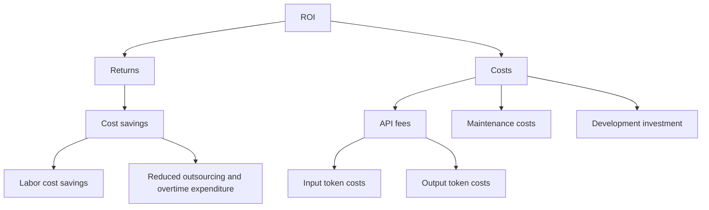

# ROI Analysis

## Returns and Costs

## Definitions and Accounting Boundaries

- **Labor cost savings:** Manual-workflow labor cost minus AI-assisted-workflow labor cost. Include input preparation, operation, correction, human review, and failed-task recovery on the AI-assisted side.
- **Reduced outsourcing and overtime expenditure:** Actual reductions in these expenses. Do not add them again if they are already included in labor cost savings.
- **API fees:** Input and output token charges are components of API fees, not additional costs to be counted a second time. Include other applicable API charges only when actually incurred.
- **Maintenance costs:** Recurring troubleshooting, prompt updates, and revalidation following model or workflow changes.
- **Development investment:** One-time prototype development, initial validation, deployment, and training.

Saved employee time can be expressed as capacity value. It becomes cash savings only when expenditure actually falls. Report capacity value and realized cash savings separately; do not count the same benefit twice.
