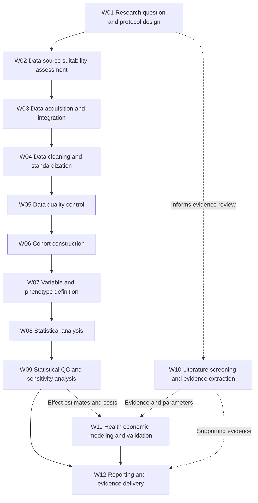

# RWE/HEOR Workflow Map and Pain Points with Evidence

**Research scope:** Retrospective observational RWE/HEOR studies using claims or EHR data, with evidence synthesis and economic evaluation as adjacent or parallel workflows.

**Important:** These tasks are a synthesized workflow map, not a universal sequence or an organization-specific SOP. Literature review and economic modeling may occur in parallel.

## Workflow diagram

**Reading note:** W10 and W11 represent parallel or adjacent activities, rather than mandatory post-analysis steps. Data QC and model validation are iterative in practice.

| ID | Workstream | Task | Typical owner | Input → output | Methods |
|---|---|---|---|---|---|
| W01 | Research planning | Research question and protocol design | HEOR scientist; epidemiologist | Clinical/business question; existing literature → Protocol; statistical analysis plan | Literature databases; protocol templates |
| W02 | Research planning | Data source selection and feasibility | RWE scientist; data lead | Research question; data catalogs; dictionaries → Data suitability assessment | DataSAT; metadata reviews |
| W03 | Data preparation | Data acquisition and integration | Data engineer; RWE analyst | Claims/EHR data; linkage rules → Linked or integrated datasets | SQL; ETL; linkage workflows |
| W04 | Data preparation | Data cleaning and standardization | Data engineer; data analyst | Raw data; source schemas → Standardized analysis-ready data | SQL; Python; SAS; OMOP |
| W05 | Data preparation | Data quality control | Data analyst; QA reviewer | Dataset; rule library → QC report; exceptions list | SQL; R; OHDSI DQD |
| W06 | Study execution | Cohort construction | Epidemiologist; programmer | Protocol; indexed data; code lists → Patient cohort; attrition flow | SQL; SAS; OHDSI ATLAS |
| W07 | Study execution | Variable and phenotype definitions | Epidemiologist; clinical expert | Coding systems; cohort; clinical algorithms → Exposure/outcome/covariate definitions | ICD; CPT; NDC; validated phenotypes |
| W08 | Statistical analysis | Statistical analysis | Biostatistician; RWE analyst | Analysis-ready dataset; SAP → Effect estimates; HRU and cost results | R; SAS; Python |
| W09 | Statistical analysis | Statistical QC and sensitivity analysis | Biostatistician; QA reviewer | Code; model outputs; SAP → Validated outputs; sensitivity results | Independent review; reproducible scripts |
| W10 | Evidence synthesis (parallel) | Literature screening and evidence extraction | HEOR researcher; evidence synthesis analyst | Search results; eligible publications → Evidence extraction tables | PubMed; screening and extraction systems |
| W11 | Economic evaluation (parallel) | Health economic model construction and validation | Health economist; modeler | Clinical effects; costs; assumptions → Economic model; validation record | Excel; R; decision models |
| W12 | Reporting and delivery | Reporting and evidence delivery | HEOR scientist; medical writer | Models; outputs; evidence tables → Final report; publication or decision materials | Word; Excel; figures; reporting checklists |

Machine-readable task inventory: [workflow_map.csv](workflow_map.csv).

## Pain points with evidence
**Pain point refinement template**

> [Role], when performing [task / responding to a trigger], faces [specific obstacle], must perform [additional work], and experiences [measurable consequence].

**Alignment note:** IDs follow the workflow inventory above. W07 focuses on endpoint derivation within variable and phenotype definitions. The source pain point table does not include a separate W09 statistical QC entry.

| Workflow ID | Workstream | Main task | Pain Points | Evidence |
|---|---|---|---|---|
| W01 | Research planning | Research question and protocol design | Translating clinical research questions into precise operational definitions (e.g., exposure periods, outcome variables, and confounders) is cumbersome and requires substantial effort and time. Differences in interpretation among researchers can undermine protocol reproducibility. Cross-team communication among statisticians, clinicians, and programmers requires considerable effort to align data elements, protocols, and methods. | ENCePP Chapter 3 (protocol standards and the HARPER template); Duke-Margolis Master Protocols (master protocols and common data elements) |
| W02 | Research planning | Data source selection and feasibility | Before purchasing or licensing data, research teams have difficulty assessing whether a particular dataset provides a sufficient sample size and the key clinical variables required. | ENCePP Chapter 3 (feasibility assessment standards); Duke-Margolis Master Protocols (fit-for-purpose assessment); IntuitionLabs RWE Platform (data source coverage analysis) |
| W03 | Data preparation | Data acquisition and integration | 1. Unstructured clinical text, such as electronic health records. 2. EHR, claims, and genomic data are siloed, and no single data source fully captures the patient's entire life course. Data are scattered across EHR systems, claims databases, and wearable devices, without a common unique patient identifier. | IntuitionLabs RWE Platform (multi-source data integration and privacy-preserving alignment); Duke-Margolis Data Curation (unstructured medical record text); Frontiers RWE & Personalized Medicine |
| W04 | Data preparation | Data cleaning and standardization | 1. Cleaning dirty data is time-consuming, including identifying and handling duplicate records, missing values, and outliers. 2. The lack of common standards requires time-consuming manual alignment. Different institutions use different coding systems, requiring manually constructed mapping tables. | Normal Workflow for Data Cleaning (standard cleaning workflow); Duke-Margolis Data Curation (terminology mapping and alignment across heterogeneous data); Logiciel Clinical Trial Data Engineering (phased cleaning and CDM mapping) |
| W05 | Data preparation | Data quality control | Small upstream data errors can propagate and become amplified through multiple pipeline stages, making error localization extremely costly. | Navigating Data Errors in ML Pipelines (error propagation and data debugging); Logiciel Clinical Trial Data Engineering (quality gates and provenance tracking) |
| W06 | Study execution | Cohort construction | Manually screening patients one by one to identify those meeting the eligibility criteria is time-consuming. | Duke-Margolis Master Protocols (inclusion/exclusion criteria and cohort screening); Baser HEOR Scoping Review (NLP-based cohort construction) |
| W07 | Study execution | Derive endpoints | 1. Each study involves complex event logic for deriving endpoints, making it difficult to reuse previous code; modifying logic and parameters is time-consuming. 2. Changes to hard-coded parameters require substantial modification effort. | Logiciel Clinical Trial Data Engineering (metadata-driven configuration and parameterization); Baser HEOR Scoping Review (extracting endpoints such as rwPFS from unstructured text) |
| W08 | Statistical analysis | Statistical analysis | 1. Confounding factors and biased data are highly likely to be present among the variables; manual work can overlook them and produce inaccurate results. 2. Small code differences in statistical models can affect result consistency, and investigating these differences is difficult and time-consuming. | Baser HEOR Scoping Review (confounding/bias control and propensity-score approaches); Duke-Margolis Master Protocols (bias control and programming standards) |
| W10 | Evidence synthesis (parallel) | Literature screening and evidence extraction | Title and abstract screening is the most time-consuming and labor-intensive stage, typically requiring manual reading of thousands of publications one by one. | Liu et al. (DFSL) (two-stage dynamic few-shot initial screening); DistillerSR Whitepaper (intelligent initial literature screening and automated stopping); Eurosurveillance (bottlenecks in literature review automation) |
| W11 | Economic evaluation (parallel) | Health economic model construction and validation | Manual work has a high error rate, including technical and logical errors and omissions due to the large number of parameters. Adjusting parameters is cumbersome. | Reason et al. (GPT-4 HEOR) (automated model construction and validation with GPT-4); Abraham et al. (Model Validation) (gaps in model validation and code verification); ISPOR GenAI in HEOR (model adaptation and Excel formula review) |
| W12 | Reporting and delivery | Reporting and evidence delivery | 1. Manually drafting compliance documentation takes months. 2. Regulatory review requirements are demanding, requiring transparent quality control records and data traceability. | ISPOR HTA Workflows (GenAI-assisted dossier and report generation); Duke-Margolis Data Curation (audit trails and data lineage); Logiciel Clinical Trial Data Engineering (compliance traceability) |

## Foundational guidelines and tools

- [ISPOR/ISPE good practices for real-world data studies](https://pmc.ncbi.nlm.nih.gov/articles/PMC5639372/)
- [NICE Real-World Evidence Framework](https://www.nice.org.uk/corporate/ecd9/chapter/overview)
- [RECORD reporting statement](https://pmc.ncbi.nlm.nih.gov/articles/PMC4595218/)
- [STROBE reporting statement](https://pmc.ncbi.nlm.nih.gov/articles/PMC2636253/)
- [OHDSI Data Quality Dashboard](https://ohdsi.github.io/DataQualityDashboard/index.html)
- [PRISMA 2020 checklist](https://www.prisma-statement.org/prisma-2020-checklist)
- [ISPOR model transparency and validation](https://www.ispor.org/heor-resources/good-practices/article/model-transparency-and-validation)
- [CHEERS 2022](https://www.ispor.org/heor-resources/good-practices/cheers)

These sources identify workflow and quality requirements; they do not establish comparative workload or customer ROI.
