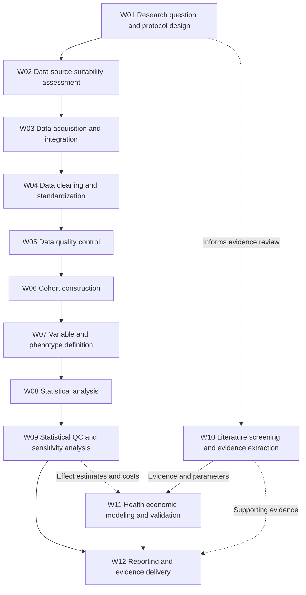

# RWE/HEOR Workflow Map

**Research scope:** Retrospective observational RWE/HEOR studies using claims or EHR data, with evidence synthesis and economic evaluation as adjacent or parallel workflows.

**Important:** These tasks are a synthesized workflow map, not a universal sequence or an organization-specific SOP. Literature review and economic modeling may occur in parallel.

## Workflow diagram

**Reading note:** W10 and W11 represent parallel or adjacent activities, rather than mandatory post-analysis steps. Data QC and model validation are iterative in practice.

| ID | Workstream | Task | Typical owner | Input → output | Methods |
|---|---|---|---|---|---|
| W01 | Research planning | Research question and protocol design | HEOR scientist; epidemiologist | Clinical/business question; existing literature → Protocol; statistical analysis plan | Literature databases; protocol templates |
| W02 | Research planning | Data source selection and feasibility | RWE scientist; data lead | Research question; data catalogs; dictionaries → Data suitability assessment | DataSAT; metadata reviews |
| W03 | Data preparation | Data acquisition and integration | Data engineer; RWE analyst | Claims/EHR data; linkage rules → Linked or integrated datasets | SQL; ETL; linkage workflows |
| W04 | Data preparation | Data cleaning and standardization | Data engineer; data analyst | Raw data; source schemas → Standardized analysis-ready data | SQL; Python; SAS; OMOP |
| W05 | Data preparation | Data quality control | Data analyst; QA reviewer | Dataset; rule library → QC report; exceptions list | SQL; R; OHDSI DQD |
| W06 | Study execution | Cohort construction | Epidemiologist; programmer | Protocol; indexed data; code lists → Patient cohort; attrition flow | SQL; SAS; OHDSI ATLAS |
| W07 | Study execution | Variable and phenotype definitions | Epidemiologist; clinical expert | Coding systems; cohort; clinical algorithms → Exposure/outcome/covariate definitions | ICD; CPT; NDC; validated phenotypes |
| W08 | Statistical analysis | Statistical analysis | Biostatistician; RWE analyst | Analysis-ready dataset; SAP → Effect estimates; HRU and cost results | R; SAS; Python |
| W09 | Statistical analysis | Statistical QC and sensitivity analysis | Biostatistician; QA reviewer | Code; model outputs; SAP → Validated outputs; sensitivity results | Independent review; reproducible scripts |
| W10 | Evidence synthesis (parallel) | Literature screening and evidence extraction | HEOR researcher; evidence synthesis analyst | Search results; eligible publications → Evidence extraction tables | PubMed; screening and extraction systems |
| W11 | Economic evaluation (parallel) | Health economic model construction and validation | Health economist; modeler | Clinical effects; costs; assumptions → Economic model; validation record | Excel; R; decision models |
| W12 | Reporting and delivery | Reporting and evidence delivery | HEOR scientist; medical writer | Models; outputs; evidence tables → Final report; publication or decision materials | Word; Excel; figures; reporting checklists |

Machine-readable task inventory: [workflow_map.csv](workflow_map.csv).

## Foundational guidelines and tools

- [ISPOR/ISPE good practices for real-world data studies](https://pmc.ncbi.nlm.nih.gov/articles/PMC5639372/)
- [NICE Real-World Evidence Framework](https://www.nice.org.uk/corporate/ecd9/chapter/overview)
- [RECORD reporting statement](https://pmc.ncbi.nlm.nih.gov/articles/PMC4595218/)
- [STROBE reporting statement](https://pmc.ncbi.nlm.nih.gov/articles/PMC2636253/)
- [OHDSI Data Quality Dashboard](https://ohdsi.github.io/DataQualityDashboard/index.html)
- [PRISMA 2020 checklist](https://www.prisma-statement.org/prisma-2020-checklist)
- [ISPOR model transparency and validation](https://www.ispor.org/heor-resources/good-practices/article/model-transparency-and-validation)
- [CHEERS 2022](https://www.ispor.org/heor-resources/good-practices/cheers)

These sources identify workflow and quality requirements; they do not establish comparative workload or customer ROI.
